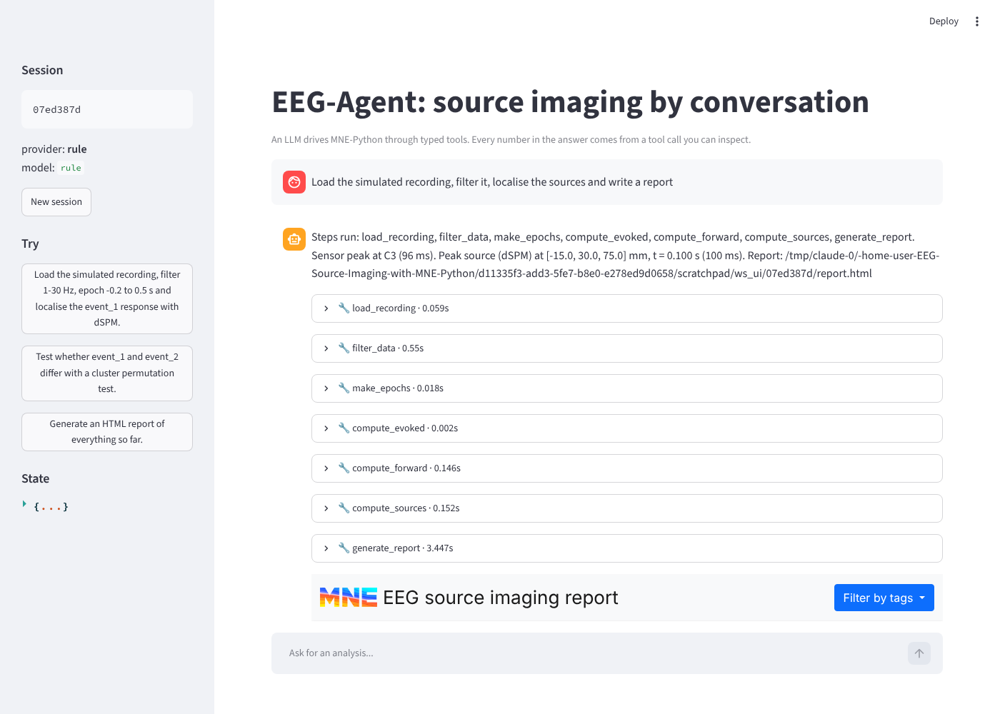

# EEG source imaging with MNE-Python, driven by an LLM agent

[](https://github.com/berdakh/EEG-Source-Imaging-with-MNE-Python/actions/workflows/ci.yml)

Three pieces, one repository:

| Package | What it is |
| --- | --- |
| **`eegsi`** | A tested library of EEG source-imaging steps on top of [MNE-Python](https://mne.tools): filtering, bad-channel detection, epoching, ICA, forward models (no-MRI sphere or fsaverage BEM), dSPM/MNE/sLORETA inverse solutions, cluster permutation statistics and HTML reports. Distilled from the research scripts in [`legacy/`](legacy). |
| **`eegagent`** | An LLM agent that runs those steps through typed tools. Ask for an analysis in plain language, get a summary whose every number comes from a tool call, plus an HTML report. Runs on Claude (Anthropic API) or on local open-weight models through Ollama. Ships with an eval suite, an HTTP API, a Streamlit UI and a Dockerfile. |
| **`eegmodels`** | A registry-driven downloader and loader for open-weight EEG foundation models (braindecode zoo, LaBraM, REVE). See [`eegmodels/README.md`](eegmodels/README.md). |

```
$ eegagent --provider rule run "Load the simulated recording, filter it, localise the sources and write a report"

  -> load_recording({"source": "simulated"})
  -> filter_data({"l_freq": 1.0, "h_freq": 30.0, "notch": null})
  -> make_epochs({"tmin": -0.2, "tmax": 0.5})
  -> compute_evoked({"condition": "event_1"})
  -> compute_forward({"model": "sphere"})
  -> compute_sources({"method": "dSPM"})
  -> generate_report({})

Steps run: load_recording, filter_data, make_epochs, compute_evoked, compute_forward,
compute_sources, generate_report. Sensor peak at C3 (96 ms). Peak source (dSPM) at
[-15.0, 30.0, 75.0] mm, t = 0.100 s (100 ms). Report: eegagent_workspace/65beb51e/report.html
```

That transcript is from the offline keyword planner (`--provider rule`); with Claude or an
Ollama model the tool calls are chosen by the LLM and the summary is written by it, but the
numbers still have to come from the tool outputs, which the eval suite checks.



## Quickstart

```bash
git clone https://github.com/berdakh/EEG-Source-Imaging-with-MNE-Python
cd EEG-Source-Imaging-with-MNE-Python
pip install -e ".[dev,api,ui]"
pytest                      # 60 tests, all offline, ~30 s

# no LLM needed: a keyword planner exercises the whole stack end to end
eegagent --provider rule run "Load the simulated recording, localise the sources and write a report"

# with Claude
export ANTHROPIC_API_KEY=...
eegagent run "Load the simulated recording, filter 1-30 Hz, epoch -0.2 to 0.5 s and localise event_1 with dSPM"

# with a local model (needs `ollama serve` and a tool-calling model, e.g. `ollama pull qwen3:8b`)
eegagent --provider ollama --model qwen3:8b chat
```

`eegagent run` prints the tool calls on stderr as they happen and the answer on stdout.
Pass a path instead of `simulated` to analyse your own recording (BrainVision, FIF, EDF, EEGLAB).

### HTTP API and web UI

```bash
eegagent serve                # FastAPI on :8000, docs at /docs
eegagent ui                   # Streamlit on :8501, talks to the API
```

or with Docker:

```bash
ANTHROPIC_API_KEY=... docker compose up     # api on :8000, ui on :8501
```

### Evals

```bash
eegagent --provider rule eval               # offline harness check, runs in CI
eegagent --provider anthropic eval          # real model
eegagent --provider ollama eval --json
```

Each case in [`eegagent/evals/cases.yaml`](eegagent/evals/cases.yaml) is a prompt plus
deterministic checks on the tool trace and the final session state, for example "the peak
source is in the left hemisphere" or "the number in the answer equals the tool output". The
runner prints a table and writes JSON results to the workspace.

## How the agent works

```
user ──▶ Agent loop ──▶ Provider (Claude | Ollama)
            │ tool calls           ▲ tool results (small JSON)
            ▼                      │
         Tools ──▶ Session state (raw, epochs, fwd, inv, stc...) ◀──▶ eegsi / MNE
```

- The LLM never sees or writes code or arrays. It picks tools and parameters; the tools
  call `eegsi` functions and return a few numbers.
- Session state persists across turns, so "now run a cluster test" works after a localisation.
- Tool failures come back as data, and the model recovers by running the missing step.
- Both providers use native tool calling. Switching is one flag or `EEGAGENT_PROVIDER`.

Details and design rationale: [`docs/ARCHITECTURE.md`](docs/ARCHITECTURE.md).
Paper plan: [`docs/PAPER_OUTLINE.md`](docs/PAPER_OUTLINE.md).

## Tools available to the agent

| Tool | Does |
| --- | --- |
| `load_recording` | File path, `simulated` (built-in synthetic 32-ch recording) or `sample` (MNE dataset) |
| `describe_state` | What exists in the session |
| `filter_data` | Zero-phase band-pass and notch |
| `detect_bad_channels` | Iterative variance-outlier detection, spherical-spline interpolation |
| `set_average_reference` | Common average reference |
| `make_epochs` | Epoching with baseline correction and amplitude rejection |
| `run_ica` | FastICA with frontal-channel artefact rejection |
| `compute_evoked` | Condition average with sensor-level peak |
| `compute_forward` | Sphere (no MRI) or fsaverage BEM leadfield |
| `compute_sources` | Noise covariance, inverse operator, MNE/dSPM/sLORETA/eLORETA, peak source |
| `cluster_test` | Spatio-temporal cluster permutation test between two conditions |
| `generate_report` | Self-contained HTML report of everything so far |
| `embed_with_foundation_model` | Embeddings from an open-weight EEG foundation model in the `eegmodels` registry |

## Using the library directly

```python
from eegsi import data, preprocessing, forward, inverse

raw = data.simulate_raw()  # or data.load_recording("sub-01.vhdr")
raw = preprocessing.apply_filters(raw, 1, 30)
epochs = preprocessing.make_epochs(raw, tmin=-0.2, tmax=0.5)
fwd = forward.make_sphere_forward(epochs.info)
cov = inverse.compute_noise_covariance(epochs, tmax=0)
inv = inverse.make_inverse(epochs, fwd, cov, loose=1.0, depth=None)
stc = inverse.apply_inverse_evoked(epochs["event_1"].average(), inv, method="dSPM")
print(inverse.peak_source(stc, fwd, tmin=0.05, tmax=0.15))
```

## Repository layout

```
eegsi/        analysis library            tests/            offline test suite
eegagent/     agent, tools, providers,    docs/             architecture, paper outline, PDF notes
              evals, server, ui           legacy/           original research scripts (unchanged)
eegmodels/    EEG foundation-model loader .github/workflows  CI: lint, tests, offline evals
```

## Status and roadmap

- [x] Library with synthetic-data tests for every stage
- [x] Agent with Claude and Ollama providers, eval suite, API, UI, Docker, CI
- [ ] Run and publish eval results for several models (see `docs/PAPER_OUTLINE.md`)
- [x] Expose `eegmodels` embeddings as an agent tool (`embed_with_foundation_model`)
- [ ] Real-data benchmark on the MNE sample dataset and MRCP recordings

## Citation

If you use this work, please cite the repository until the preprint is available:

```
Abibullaev, B. (2026). EEG-Agent: tool-grounded language agents for EEG source imaging.
https://github.com/berdakh/EEG-Source-Imaging-with-MNE-Python
```

## License

MIT.
